<div align="center">

<a href="https://github.com/ishandutta2007/Awesome-Awesome-Awesome"></a><a href="https://discord.gg/jc4xtF58Ve"></a>
<a href="https://github.com/ishandutta2007/Awesome-Cloud-Administration-Software/stargazers"></a>
<a href="https://github.com/ishandutta2007/Awesome-Cloud-Administration-Software/network/members"></a>
<a href="https://github.com/ishandutta2007/Awesome-Cloud-Administration-Software/issues"></a>
<a href="https://github.com/ishandutta2007/Awesome-Cloud-Administration-Software/blob/main/LICENSE"></a>
<a href="https://github.com/ishandutta2007"></a>

<br />
<br />



# ☁️ Awesome Cloud Administration Software 🚀

**Curated Directory of Cloud Administration Platforms, SaaS Management (SMP), Identity & Access Governance (IAM), Multi-Tenant Operations & Shadow IT Discovery Tools.**

[](https://github.com/ishandutta2007/Awesome-Cloud-Administration-Software/pulls)
[](https://github.com/ishandutta2007/Awesome-Cloud-Administration-Software/graphs/commit-activity)
[](https://github.com/ellerbrock/open-source-badges/)

---

</div>

## 📌 Table of Contents

- [🌐 Sector Overview & Market Dynamics](#-sector-overview--market-dynamics)
- [🏢 SaaS & Hosted Platforms](#-saas--hosted-platforms)
- [🔓 Open-Source GitHub Projects](#-open-source-github-projects)
- [🛠️ Frameworks & Architecture Blueprint](#️-frameworks--architecture-blueprint)
- [🤝 How to Contribute](#-how-to-contribute)
- [📜 Disclaimer & Architecture Notes](#-disclaimer--architecture-notes)
- [💖 Support & Sponsorship](#-support--sponsorship)
- [📈 Star History](#-star-history)

---

## 🌐 Sector Overview & Market Dynamics

The cloud administration, SaaS Management Platform (SMP), and Identity & Access Governance (IAM) sector is estimated at **$28.5 billion globally in 2026** (projected to exceed $45 billion by 2030 at a ~14.8% CAGR), driven by hyper-sprawl of cloud applications, compliance audits, and remote workforce access governance. The market exhibits **moderate fragmentation with high concentration at the foundational infrastructure layer**; hyperscaler suites (Microsoft 365 Admin, Google Workspace Admin) and enterprise IAM giants (Okta, Ping Identity, Microsoft Entra ID) command dominant core tenant footprints, while the specialized SaaS rationalization, license optimization, and shadow IT management segment remains an active, fragmented playing field contested by nimble agile platforms (BetterCloud, Lumos, Torii, Zylo) and rising self-hosted open-source alternatives.

---

## 🏢 SaaS & Hosted Platforms

> [!NOTE]
> All proprietary commercial vendors below are ranked in descending order based on estimated company valuation or annual recurring revenue (ARR).

| Product | Valuation / Revenue | Starting Pricing Tier | Free Tier / Trial Limit | Key Capabilities & Highlights |
| :--- | :--- | :--- | :--- | :--- |
| **[Microsoft 365 Admin Center](https://admin.microsoft.com/)** | **$3.1+ Trillion Market Cap** (Microsoft) | Included with M365 Business Basic ($6.00/user/month) | 30-day free trial (up to 25 user licenses) | Native administrative console for centralized user management, tenant security policies, Exchange/SharePoint controls, and license allocation. |
| **[Google Workspace Admin](https://admin.google.com/)** | **$2.2+ Trillion Market Cap** (Alphabet) | Included with Business Starter ($7.20/user/month) | 14-day free trial (up to 10 user licenses) | Centralized administrative console for Google Workspace users, 2-Step Verification enforcement, organizational units, and mobile device management (MDM). |
| **[Atlassian Administration](https://admin.atlassian.com/)** | **$45+ Billion Market Cap** (Atlassian) | Free plan available; Standard starting at $8.15/user/month | Free forever tier (up to 10 users for Jira & Confluence) | Centralized cloud user directory, role assignments, audit logs, single sign-on (SSO), and Atlassian Access domain verification. |
| **[Rippling](https://www.rippling.com/)** | **$13.5 Billion Valuation** | Starting bundle approx. $8.00/employee/month (core Unity platform) | 14-day guided product demonstration & sandbox trial (upon request) | Unified IT cloud platform combining employee lifecycle onboarding, automated zero-touch computer provisioning, app access, and unified directory. |
| **[JumpCloud](https://jumpcloud.com/)** | **$2.6 Billion Valuation** | Cloud Directory starting at $9.00/user/month (annual billing) | Free forever plan (up to 10 users & 10 devices, with 10 days premium chat support) | Complete open directory platform delivering cloud IAM, cross-OS device management (Mac, Windows, Linux), MFA, RADIUS, and SSO. |
| **[BetterCloud](https://www.bettercloud.com/)** | **$1.0+ Billion Valuation** (Acquired by Vista Equity) | Starting tiers typically from $3.00 to $5.00/user/month (~$10,000/year minimum) | 14-day free trial with sandbox connector limits (requires sales verification) | Comprehensive SaaS Management Platform (SMP) featuring zero-touch automated offboarding/onboarding workflows and deep SaaS posture governance. |
| **[Zylo](https://www.zylo.com/)** | **$500+ Million Valuation** | SaaS management packages starting around $15,000/year | 14-day free trial on guided discovery dataset (no permanent free tier) | Enterprise SaaS rationalization platform optimizing contract renewals, license utilization metrics, shadow spend discovery, and benchmarking. |
| **[Productiv](https://www.productiv.com/)** | **$400+ Million Valuation** | Tiered entry packages starting around $12,000 to $15,000/year | 14-day guided proof-of-concept trial (no permanent free tier) | SaaS intelligence and engagement platform analyzing real-time user feature adoption, automated license reclamation, and contract renewal workflows. |
| **[Torii](https://www.torii.com/)** | **$300+ Million Valuation** | Starter packages starting at approx. $8,000/year | 14-day free trial with live SaaS discovery integration (no permanent free tier) | Continuous shadow IT discovery, automated SaaS license lifecycle management, contract cataloging, and plug-and-play workflow orchestration. |
| **[Lumos](https://www.lumos.com/)** | **$200+ Million Valuation** | Starting packages approx. $3.00 to $4.00/user/month (~$7,500/year minimum) | 14-day sandbox access and proof-of-concept trial (no permanent free tier) | AppStore-style self-service access request portal with multi-step manager approvals, just-in-time (JIT) access, and automated license harvesting. |

---

## 🔓 Open-Source GitHub Projects

> [!TIP]
> The table below is ranked in descending order by **GitHub Star Count**. Every star badge links directly to the repository's stargazers community page.

| Repository | GitHub Stars | License | Primary Tech Stack | Description & Cloud Administration Role |
| :--- | :--- | :--- | :--- | :--- |
| **[Keycloak](https://github.com/keycloak/keycloak)** | [](https://github.com/keycloak/keycloak/stargazers) | Apache-2.0 | Java / Quarkus | Industry-standard open-source identity and access management (IAM) server providing Single Sign-On (SSO), OpenID Connect, SAML 2.0, user federation (LDAP/Active Directory), and centralized realm administration. |
| **[Authelia](https://github.com/authelia/authelia)** | [](https://github.com/authelia/authelia/stargazers) | Apache-2.0 | Go / TypeScript | Lightweight authentication and authorization server providing two-factor authentication (2FA/MFA) and single sign-on (SSO) for internal web apps behind reverse proxies (Nginx, Traefik, Caddy, Envoy). |
| **[Authentik](https://github.com/goauthentik/authentik)** | [](https://github.com/goauthentik/authentik/stargazers) | AGPL-3.0 | Python / Go | Versatile open-source identity provider (IdP) focusing on flexibility and enterprise integration. Features SCIM provisioning, user self-service flows, dynamic access policies, and unified enterprise app portals. |
| **[Zitadel](https://github.com/zitadel/zitadel)** | [](https://github.com/zitadel/zitadel/stargazers) | Apache-2.0 | Go / TypeScript | Cloud-native multi-tenant identity infrastructure with turn-key user management, passkeys/FIDO2, audit trails, and B2B SaaS authorization architecture. |
| **[Casdoor](https://github.com/casdoor/casdoor)** | [](https://github.com/casdoor/casdoor/stargazers) | Apache-2.0 | Go / React | UI-first identity and access management platform supporting OAuth 2.0, OIDC, SAML, WebAuthn, multi-tenancy, and 50+ third-party social logins and identity providers. |
| **[Dex IdP](https://github.com/dexidp/dex)** | [](https://github.com/dexidp/dex/stargazers) | Apache-2.0 | Go | Pluggable OpenID Connect (OIDC) and OAuth 2.0 identity federation broker that connects applications to SAML, LDAP, GitHub, GitLab, and external directories. |
| **[Steampipe](https://github.com/turbot/steampipe)** | [](https://github.com/turbot/steampipe/stargazers) | AGPL-3.0 | Go / PostgreSQL | Zero-ETL query engine to audit, discover, and inspect multi-cloud tenants, SaaS services (Google Workspace, Slack, GitHub, AWS, Azure, M365), and security postures using SQL. |
| **[CloudQuery](https://github.com/cloudquery/cloudquery)** | [](https://github.com/cloudquery/cloudquery/stargazers) | MPL-2.0 | Go | High-performance open-source ELT data integration framework that syncs cloud tenants, SaaS assets, and IAM configurations to databases for governance and compliance analytics. |
| **[osTicket](https://github.com/osTicket/osTicket)** | [](https://github.com/osTicket/osTicket/stargazers) | GPL-2.0 | PHP / MySQL | Widely deployed open-source IT service management and support ticketing system used by IT administrators for internal cloud helpdesk routing and service provisioning requests. |
| **[Nubus](https://github.com/univention/nubus)** | [](https://github.com/univention/nubus/stargazers) | AGPL-3.0 | Python / Go / Shell | Modular identity and access management system built by Univention. Features central self-service web portals, user lifecycle automation, and high data-privacy compliance (GDPR). |
| **[Idenplane](https://github.com/idenplane/idenplane)** | [](https://github.com/idenplane/idenplane/stargazers) | MIT | TypeScript / NestJS | Ultra-lightweight self-hosted IAM server (~150MB RAM footprint) featuring adaptive risk-based authentication, multi-tenant realms, SCIM provisioning, and Auth0/Keycloak migration tooling. |
| **[SaaS Security Posture Dashboard](https://github.com/CyberEnthusiastic/saas-security-posture)** | [](https://github.com/CyberEnthusiastic/saas-security-posture/stargazers) | MIT | Python (Stdlib) | Pure Python self-hosted SaaS inventory and rationalization analysis tool that detects unapproved shadow IT tools, scores OAuth token security risks, and pinpoints duplicate subscription spend. |
| **[Hanzo IAM](https://github.com/hanzoai/iam)** | [](https://github.com/hanzoai/iam/stargazers) | Apache-2.0 | Go | Protocol-rich AI-ready identity access management server supporting WebAuthn, Passkeys, TOTP, SAML, CAS, LDAP, and SCIM protocol lifecycle provisioning. |

---

## 🛠️ Frameworks & Architecture Blueprint

```
+-----------------------------------------------------------------------------------------+
|                               ENTERPRISE IT STACK LAYERS                                |
+-----------------------------------------------------------------------------------------+
|  1. SaaS Discovery & Spend Audit:  Steampipe / CloudQuery / SaaS-Security-Posture       |
|  2. Identity & Access Governance:  Keycloak / Authentik / Zitadel / Casdoor / Nubus     |
|  3. Self-Service App Requests:     Lumos (SaaS) / Authentik Flows / Keycloak Realms     |
|  4. Central Tenant Administration: Microsoft 365 Admin / Google Workspace Admin         |
|  5. IT Service Desk Routing:       osTicket / Qisutu                                    |
+-----------------------------------------------------------------------------------------+
```

Organizations seeking to build a self-hosted cloud administration stack can combine:
1. **SaaS Discovery & Posture Auditing**: Use **Steampipe** and **CloudQuery** for real-time cloud and SaaS API asset extraction, combined with **SaaS Security Posture Dashboard** for static shadow IT spend rationalization.
2. **Access Governance & Single Sign-On**: Deploy **Keycloak**, **Authentik**, or **Zitadel** to establish an enterprise IdP with OAuth2, OIDC, SAML, and SCIM automated provisioning.
3. **IT Service Administration**: Wire up **osTicket** to handle manual IT administrative approvals, service requests, and hardware/software dispatching.

---

## 🤝 How to Contribute

Contributions are warmly welcomed! Help make this curated knowledge base even better:

1. 🍴 **Fork the repository** on GitHub.
2. 🌿 **Create a new topic branch** (`git checkout -b feature/add-cloud-admin-tool`).
3. 📝 **Add your entry** following the tabular format above with transparent pricing, verified limits, and accurate licensing.
4. 🧪 **Check link validity** to ensure no broken references.
5. 🚀 **Submit a Pull Request** with a clear explanation of why the software belongs in this collection.

---

## 📜 Disclaimer & Architecture Notes

- This repository is a **community-curated guide** intended for informational, architectural, and educational purposes.
- Mentions of commercial SaaS platforms do not constitute endorsements; pricing tiers and limits fluctuate over time and should be confirmed directly with respective vendors.
- Self-hosted administrative systems hold sensitive master credentials and directories. Always ensure proper TLS termination, zero-trust network segregation, automated database backup policies, and multi-factor authentication (MFA/FIDO2) before exposing administrative interfaces to public networks.

---

## 💖 Support & Sponsorship

If this curated repository saved you hours of research or helped optimize your cloud administration infrastructure, please consider supporting the project:

- ⭐ **Star this repository** to help others discover it!
- 🍴 **Fork and share** with fellow DevOps engineers and IT administrators.
- ☕ **Buy me a coffee**: Support ongoing open-source maintenance directly on the [**GitHub Sponsors Dashboard**](https://github.com/sponsors/ishandutta2007).

---

## 📈 Star History

[](https://star-history.dera.page/#ishandutta2007/Awesome-Cloud-Administration-Software&type=date&legend=top-left)
